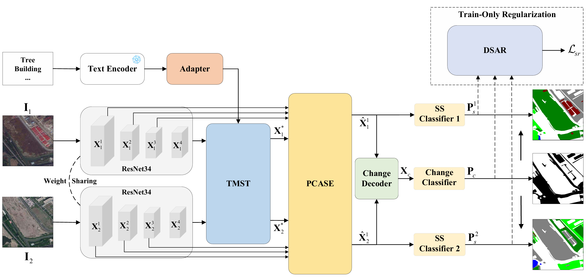

# TMOTNet

This repository provides the code for the method in our paper '**Text-Mediated Optimal Transport Network for Remote Sensing Semantic Change Detection**'.

If you have any questions, you can send me an email. My mail address is 24171213924@stu.xidian.edu.cn.

<p align="center">
  
</p>

## Requirements
- Python 3.8+
- PyTorch 1.7+
- torchvision
- scikit-image
- numpy
- tensorboardX

## Datasets

- **SECOND**
- **Landsat-SCD**

## Training

```bash
# Train on SECOND dataset
python train_SECOND.py

# Train on Landsat-SCD dataset
python train_Landsat.py
```

## Inference

```bash
python inference.py
```

